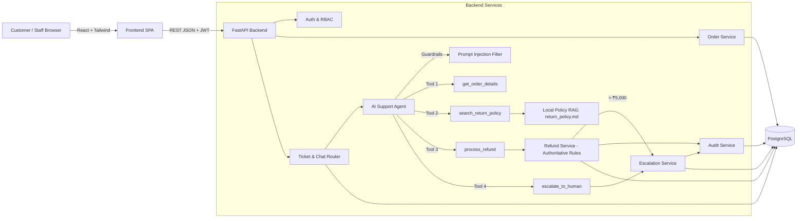
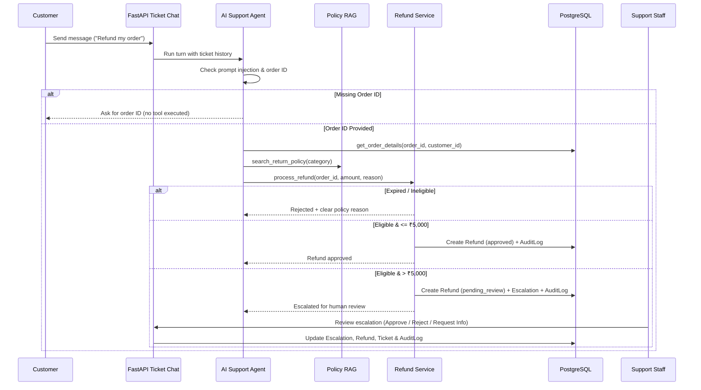

# SupportDesk Architecture

## System Overview

SupportDesk separates conversational AI assistance from authoritative backend enforcement. The React frontend communicates exclusively with FastAPI REST endpoints protected by JWT authentication and role-based authorization (`customer` vs `agent`/`admin`). All business rules (ownership, delivery status, category return windows, ₹5,000 automated refund threshold, and idempotency keys) are enforced inside backend Python services backed by PostgreSQL.

## AI Agent & Human Review Flow

