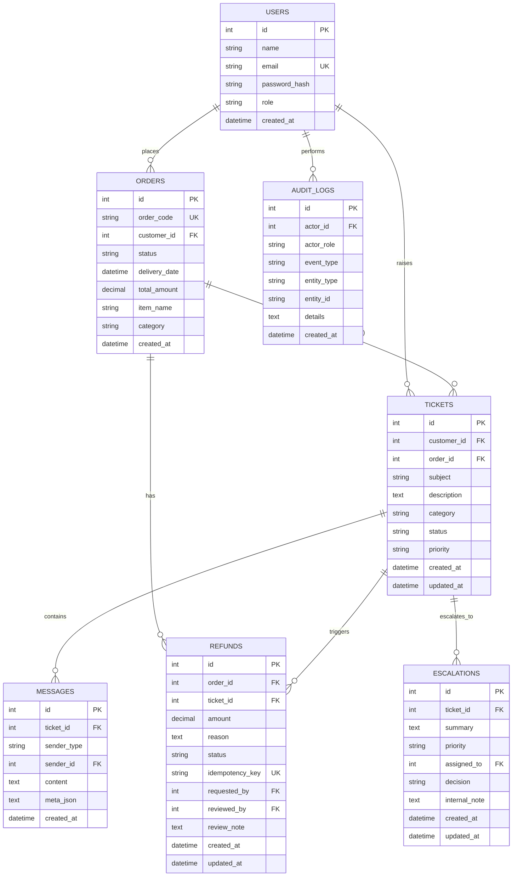

# SupportDesk Database Schema & ER Diagram

All persistent entities live in PostgreSQL, managed with Alembic migrations (`backend/alembic/versions/0001_initial_schema.py`) and SQLAlchemy 2.0 ORM models (`backend/app/models.py`).

## Entity-Relationship Diagram

## Key Indexes & Constraints
- `users.email` (Unique Index): Prevents duplicate account registration.
- `orders.order_code` (Unique Index) & `orders.customer_id` (FK -> `users.id`): Fast customer-scoped lookups.
- `tickets.(status, priority)` (Composite Index): Fast filtering in the internal support dashboard.
- `refunds.idempotency_key` (Unique Index): Server-side guarantee against duplicate refund submissions.
- `audit_logs.(event_type, created_at)`: Fast chronological inspection of security and refund events.
